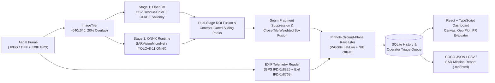

# SARVision AI (`sarvision-ai`)

> **Offline-capable, Dual-Stage Computer Vision & Geospatial Intelligence System for Aerial Search & Rescue (SAR)**

[](./LICENSE)
[](https://www.python.org/)
[](https://onnxruntime.ai/)
[](./frontend/)

SARVision AI ingests high-resolution UAV imagery, partitions frames into overlapping tiles, fuses OpenCV HSV rescue-color/CLAHE saliency proposals with offline ONNX Runtime neural classification (plus automatic support for drop-in YOLOv8/YOLOv11 ONNX weights), merges cross-tile detections via Weighted Box Fusion (WBF), raycasts pixel centers onto WGS84 coordinates using real EXIF GPS/gimbal geometry, and provides a human-in-the-loop React + TypeScript triage dashboard.

---

## System Architecture



See [`docs/ARCHITECTURE.md`](./docs/ARCHITECTURE.md) for mathematical derivation of the NED pinhole camera raycaster and tile-seam merging algorithm.

---

## Core Capabilities

- **High-Resolution Overlapping Tiler & Cross-Tile Fusion (`backend/cv_engine/tiler.py`)**: Splits large images into `640×640` tiles (`20%` overlap), suppresses clipped internal-seam fragments via containment checking, and merges cross-tile detections with Weighted Box Fusion (WBF) / greedy NMS.
- **Dual-Stage Offline Detection (`backend/cv_engine/detector.py`)**:
  - **Stage 1 (OpenCV):** International rescue-orange/red, safety-yellow, and alpine cyan HSV channels paired with LAB CLAHE local-contrast saliency and Sobel gradient gating.
  - **Stage 2 (ONNX Runtime):** Built-in `SARVisionMicroNet-v1` PyTorch→ONNX CNN (`193,085` params, `756.48 KB`, `99.90%` patch validation accuracy) classifying `person`, `life_raft`, `vehicle`, `distress_marker`, and `background`.
  - **Drop-In YOLOv8 / YOLOv11 Support:** Place any custom YOLOv8/YOLOv11 `.onnx` file inside `models/` and select it via UI/API (`(1, 4+C, N)`, `(1, N, 4+C)`, and `(1, N, 6)` outputs auto-detected).
- **EXIF GPS & Pinhole Raycasting (`backend/cv_engine/exif_geo.py`)**: Reads binary JPEG/TIFF EXIF GPS tags + focal length / AGL altitude / gimbal pitch / heading and projects every detection center into WGS84 `(lat, lon)`, local `(North, East)` meter offsets, and slant range.
- **COCO Evaluator (`backend/cv_engine/evaluator.py`)**: Computes exact `N_gt × N_pred` IoU matrices, Precision, Recall, F1-score, interpolated AP@0.5, mAP, and mean IoU against COCO `ground_truth.json`.
- **Human-in-the-Loop Triage & Reporting (`backend/main.py`, `backend/cv_engine/reporter.py`, `frontend/`)**: Drag-and-drop single & batch upload, confidence/NMS/overlap tuning, tile seam overlay, Confirm / False Positive / Escalate / Reclassify workflow persisted to SQLite, tactical WGS84 ground plot, and COCO JSON / CSV / Markdown / HTML mission report exports.

---

## Evaluation Benchmarks (Measured on Synthetic SAR Benchmark)

> **Note:** The included `sample_data/` imagery is a **clearly labeled synthetic evaluation dataset** (`3 × 1920×1280` scenes, `12` ground-truth targets across wilderness clearing, maritime swell, and alpine snowfield with embedded EXIF GPS tags).

Evaluated live at `conf_threshold = 0.45`, `nms_iou_threshold = 0.40`, `tile_size = 640`, `tile_overlap = 0.20`, `IoU match >= 0.50`:

### Detector Mode Ablation

| Detector Mode | TP | FP | FN | Precision | Recall | F1-Score | mAP@0.5 | Mean IoU | Avg Latency |
|---|---:|---:|---:|---:|---:|---:|---:|---:|---:|
| **`fusion` (OpenCV + ONNX CNN)** | **12** | **0** | **0** | **100.0%** | **100.0%** | **1.0000** | **1.0000** | **0.7699** | 2063.3 ms/img |
| `opencv` (HSV + CLAHE only) | 8 | 5 | 4 | 61.5% | 66.7% | 0.6400 | 0.4583 | 0.7208 | 252.7 ms/img |
| `onnx` (Sliding-Window only) | 6 | 72 | 6 | 7.7% | 50.0% | 0.1333 | 0.1839 | 0.5963 | 1712.3 ms/img |

### Per-Class Performance (`fusion` Mode)

| Target Class | GT Count | TP | FP | FN | Precision | Recall | F1 | AP@0.5 | Mean IoU |
|---|---:|---:|---:|---:|---:|---:|---:|---:|---:|
| `person` | 5 | 5 | 0 | 0 | 1.0000 | 1.0000 | 1.0000 | 1.0000 | 0.5971 |
| `life_raft` | 2 | 2 | 0 | 0 | 1.0000 | 1.0000 | 1.0000 | 1.0000 | 0.8564 |
| `vehicle` | 2 | 2 | 0 | 0 | 1.0000 | 1.0000 | 1.0000 | 1.0000 | 0.9487 |
| `distress_marker` | 3 | 3 | 0 | 0 | 1.0000 | 1.0000 | 1.0000 | 1.0000 | 0.8808 |

---

## Quickstart & Offline Operation

### 1. Install Dependencies
```bash
python -m pip install -r requirements.txt
```

### 2. Run Completely Offline (Pre-Built Assets Included)
`models/sarvision_micro_detector.onnx`, `sample_data/`, and `frontend/dist/` are ready to run offline immediately:
```bash
uvicorn backend.main:app --host 127.0.0.1 --port 8000
```
Open **`http://127.0.0.1:8000`** for the tactical dashboard, or **`http://127.0.0.1:8000/docs`** for OpenAPI docs.

### 3. Regenerate Model & Synthetic Imagery (Optional)
```bash
# Train SARVisionMicroNet-v1 & export ONNX + metadata
python scripts/export_sar_onnx_model.py

# Regenerate 3 EXIF-geotagged synthetic 1920x1280 SAR scenes + ground_truth.json
python scripts/generate_sar_test_imagery.py
```

### 4. Frontend Development Mode (Optional)
```bash
cd frontend
npm install
npm run dev       # Dev server on http://localhost:5173 proxying /api -> :8000
npm run build     # Rebuilds production static bundle into frontend/dist/
```

### 5. Run Test Suite
```bash
python -m pytest tests -v
```

---

## Using Custom YOLOv8 / YOLOv11 ONNX Weights
1. Export your YOLO weights: `yolo export model=your_sar_yolov8n.pt format=onnx imgsz=640`
2. Copy `your_sar_yolov8n.onnx` into `models/`
3. Select the model from the sidebar dropdown (or pass `model_name=your_sar_yolov8n.onnx` to `/api/analyze`).

---

## Project Layout

```text
02-SARVISION/
├── backend/
│   ├── cv_engine/
│   │   ├── detector.py      # Dual-stage OpenCV + ONNX / YOLO inference engine
│   │   ├── evaluator.py     # COCO IoU matrix, Precision, Recall, F1, mAP evaluator
│   │   ├── exif_geo.py      # JPEG/TIFF EXIF GPS reader & pinhole WGS84 raycaster
│   │   ├── reporter.py      # COCO JSON, CSV, Markdown & HTML mission reports
│   │   └── tiler.py         # 640x640 overlapping tiler, seam suppression, global WBF/NMS
│   ├── config.py            # Pydantic Settings (.env support)
│   ├── database.py          # SQLAlchemy 2.0 engine & session factory
│   ├── main.py              # FastAPI REST endpoints & built SPA static host
│   ├── models.py            # AnalysisRun & DetectionRecord ORM models
│   └── schemas.py           # Pydantic V2 API contracts
├── docs/
│   └── ARCHITECTURE.md      # Technical architecture & raycasting derivation
├── frontend/                # React 18 + TypeScript + Vite dashboard + built dist/
├── models/                  # sarvision_micro_detector.onnx + model_metadata.json
├── sample_data/             # 3 geotagged 1920x1280 synthetic SAR scenes + ground_truth.json
├── scripts/
│   ├── export_sar_onnx_model.py
│   └── generate_sar_test_imagery.py
├── tests/                   # Unit & FastAPI integration test suite
├── .env.example
├── .gitignore
├── LICENSE                  # MIT
├── ROADMAP.md
└── requirements.txt
```

---

## License

MIT License — see [`LICENSE`](./LICENSE).
