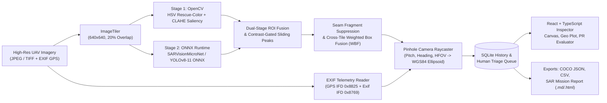

# SARVision AI — System Architecture

## Overview

SARVision AI (`sarvision-ai`) is an offline-capable aerial Search & Rescue (SAR) computer vision and geospatial intelligence system. It processes high-resolution drone imagery (JPEG/TIFF/PNG) across four engineering subsystems:

1. **High-Resolution Overlapping Tiler & Global NMS (`backend/cv_engine/tiler.py`)**
2. **Dual-Stage CV/ML Target Detector (`backend/cv_engine/detector.py`)**
3. **EXIF Telemetry & Pinhole Ground-Plane Raycaster (`backend/cv_engine/exif_geo.py`)**
4. **COCO Evaluator, Operator Triage Persistence & Intelligence Reporting (`evaluator.py`, `reporter.py`, `models.py`, `main.py`, `frontend/`)**

---

## Processing Pipeline

---

## Subsystem Details

### 1. High-Resolution Tiling & Seam Deduplication
Small aerial SAR targets (`26×30 px` hikers in a `1920×1280` frame) lose spatial fidelity when downscaled to single-shot `640×640` detector inputs. `ImageTiler` partitions full frames into `640×640` tiles with `20%` overlap (`stride = 512 px`), clamps right/bottom edge tiles to maintain aspect ratio, and projects tile-local detections back into global pixel coordinates.

At tile seams (`x=512, 640, 1024, 1280`, `y=512, 640`), `suppress_seam_fragments()` identifies partial clipped detections touching internal tile boundaries that have `>= 68%` containment inside an adjacent full-view detection, before `_weighted_box_fusion()` merges corroborated detections across overlapping tiles.

### 2. Dual-Stage Inference Engine & Model Interchangeability
`SARDetector` supports three runtime modes (`fusion`, `onnx`, `opencv`):
- **Stage 1 (OpenCV):** Combines HSV rescue-color segmentation (international orange/red, safety yellow, alpine cobalt/cyan) with LAB CLAHE local-contrast saliency and Sobel edge-gradient validation.
- **Stage 2 (ONNX Runtime):** Automatically inspects `.onnx` tensor signatures in `models/`:
  - **Built-in `SARVisionMicroNet-v1`** (`(B, 3, 64, 64) -> (B, 5)`): Batch-classifies context-padded Stage-1 ROIs (`background`, `person`, `life_raft`, `vehicle`, `distress_marker`) to reject natural terrain clutter (autumn leaves, ocean whitecaps, snow rocks) and supplements with contrast-gated multi-scale neural sliding-window peaks.
  - **Drop-in YOLOv8 / YOLOv11 ONNX weights**: Automatically switches to letterbox tile inference when a YOLO-shaped ONNX output tensor (`(1, 4+C, N)`, `(1, N, 4+C)`, or `(1, N, 6)`) is detected.

### 3. Pinhole Camera Ground-Plane Geolocation
`read_exif_telemetry()` extracts WGS84 DMS GPS coordinates, altitude, `GPSImgDirection`, and 35mm equivalent focal length directly from binary JPEG/TIFF EXIF IFDs (`0x8825` / `0x8769`).

For every detection center `(px, py)`:
1. Construct normalized camera-frame ray `[ (px - W/2)/f_px, (py - H/2)/f_px, 1 ]`.
2. Rotate by `tilt = 90° + gimbal_pitch_deg` from nadir into unrotated North-East-Down (NED).
3. Rotate horizontally by UAV true heading `heading_deg`.
4. Intersect with flat ground plane at depth `AGL` (`t = AGL / D_ned`), giving local `(north_m, east_m)` and `slant_range_m`.
5. Convert metric offsets using WGS84 meridional (`M`) and prime vertical (`N`) curvature radii at `lat0`.

### 4. Persistence, Verification & Evaluation
- **SQLite + SQLAlchemy 2.0:** Persists `AnalysisRun` telemetry/tiling snapshots and per-target `DetectionRecord` triage states (`pending`, `confirmed`, `escalated`, `false_positive`, `verified_class_name`, `operator_notes`).
- **COCO Evaluator:** Computes exact `N_gt × N_pred` IoU matrices, 1-to-1 confidence-ranked matching, per-class Precision, Recall, F1, and interpolated AP@0.5.
